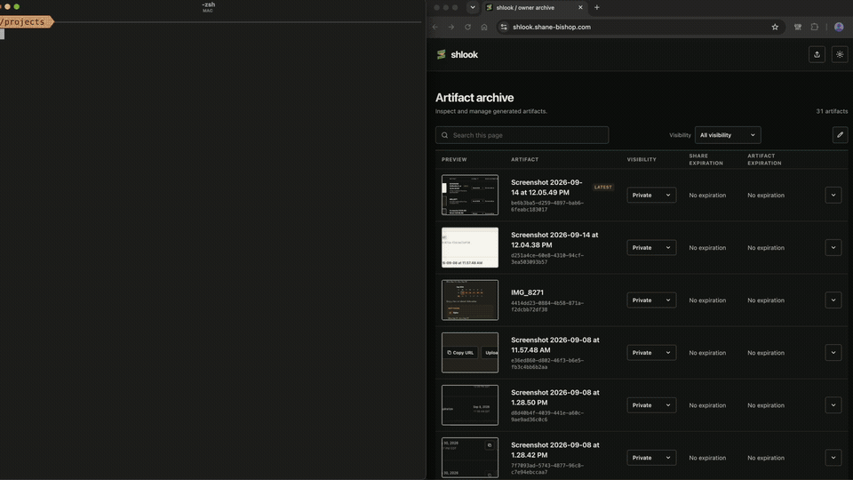

# shlook

[](https://www.npmjs.com/package/shlook)
[](https://github.com/shanebishop1/shlook/actions/workflows/ci.yml)

Share artifacts through a private library hosted locally (LAN/Tailscale) or on Cloudflare.

- **Working over SSH:** have your agent publish a page or image and open its link, without copying
  files back or exposing a development server for each preview.
- **Reviewing on your phone:** open the artifact, then upload a screenshot through the mobile web
  app for your agent to retrieve and inspect. The same library works in both directions.

Use the web app on any device with a modern browser. Any coding agent that can run CLI commands
can use shlook; the included skill documents the workflow, without tying it to one agent app.

See [self-hosting](skills/shlook/references/self-host.md) or [Cloudflare setup](skills/shlook/references/setup.md).



## Quick start

Install the skill for your coding agent:

```bash
npx skills add shanebishop1/shlook
```

Ask your agent to set up Shlook, or configure an [instance profile](skills/shlook/references/instances.md).

## Alternatives

- **SCP or [croc](https://github.com/schollz/croc):** useful for file transfer. SCP needs an
  SSH-accessible destination; croc needs a receiving client. Shlook gives you a saved viewing link
  instead of requiring a transfer to each device.
- **[Tailscale Serve](https://tailscale.com/kb/1312/serve):** can serve static artifacts, especially
  if you already use Tailscale. Configuring serving and tailnet access just to view a quick artifact
  can be more effort than needed; shlook uses the same preconfigured publishing workflow each time.
- **[Zipline](https://github.com/diced/zipline) or [Chibisafe](https://github.com/chibisafe/chibisafe):**
  broader screenshot and file-hosting tools. Shlook focuses on private-by-default HTML/image exchange
  with an agent skill and an automated Cloudflare deployment recipe.

## Limits

| Limit                         | Value                     |
| ----------------------------- | ------------------------- |
| Maximum file size             | 25 MiB                    |
| Maximum publication size      | 100 MiB                   |
| Maximum files per publication | 500                       |
| Abandoned upload cleanup      | 24 hours without progress |

## Publish an artifact

Every new publication has a concise display name and may have a description:

```bash
shlook publish ./artifact \
  --name "Owner archive refinement" \
  --description "Responsive archive controls and theme study" \
  --json
```

Names accept 1-80 characters; descriptions accept up to 500. Both appear in the archive and API.
Publication defaults to private.
`shlook publish --json` returns `data.url` as the authenticated private viewing URL, not a public
or secret-link URL. Static bundles should use relative asset URLs such as `./app.js` and
`./styles.css`, not root-relative `/assets/...` URLs.

The creation API accepts the same metadata as JSON:

```json
{
  "name": "Owner archive refinement",
  "description": "Responsive archive controls and theme study"
}
```

For command grammar, JSON behavior, and environment-profile rules, see the
[commands reference](skills/shlook/references/commands.md).

Requires Node.js 24+ on macOS or Linux.

## Documentation

- [Setup](skills/shlook/references/setup.md)
- [Instances and authentication](skills/shlook/references/instances.md)
- [Native self-hosting](skills/shlook/references/self-host.md)
- [Publishing and Markdown](skills/shlook/references/publish.md)
- [Commands](skills/shlook/references/commands.md)
- [Security](skills/shlook/references/security.md)
- [Security model and routes](docs/security-model.md)
- [Verification](skills/shlook/references/verification.md)
- [Development](docs/development.md)

## License

MIT. See [`LICENSE`](LICENSE).
